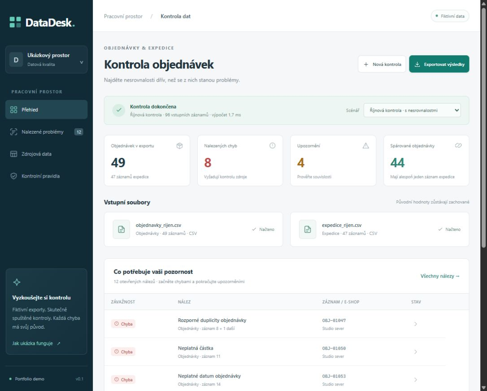

# DataDesk

DataDesk is a Czech portfolio application for reconciling fictional order and shipment exports. It turns raw CSV data into explainable findings with source-row provenance. The same validation engine runs in the browser and a Node CLI.



## What it demonstrates

- Deterministic validation: missing and orphaned shipments, duplicate and conflicting IDs, quantity and date checks, invalid fields, and currency-separated totals.
- Browser-local CSV import, source inspection, findings filters, review notes, and CSV/JSON exports. Review notes never change findings or original data.
- Defensive CSV parsing and export: schema and size limits, reserved-header rejection, safe text rendering, and spreadsheet-formula neutralization.
- Reproducible tests and a 20,000 + 20,000 row benchmark, including a duplicate-heavy case.

## Run locally

Requires Node.js 22 or newer. There are no package dependencies or API keys.

```sh
npm start
```

Open http://127.0.0.1:4173. The app includes three fictional scenarios. To import your own data, select one orders CSV and one shipments CSV; each may contain at most 20,000 records and 2,000,000 bytes. The interface shows the required columns. CSV is the supported format; XLSX is not supported in this version.

```sh
npm test
npm run benchmark
npm run demo:report
npm run build
```

The CLI also accepts `orders.csv shipments.csv [report.json]`. With no arguments it prints a report for the prepared example. The static build is written to `dist/`.

## Data and review limitations

All included names, shops and emails are fictional. Browser imports are processed in the page; the application has no upload service. Review notes for prepared scenarios are stored in that browser's local storage. Notes for imported files are held only in memory. This is a portfolio demonstration, not a shared or tamper-proof audit system.

See [project scope](docs/PROJECT.md), [decisions](docs/DECISIONS.md), [status](docs/STATUS.md) and [QA evidence](docs/QA.md).
